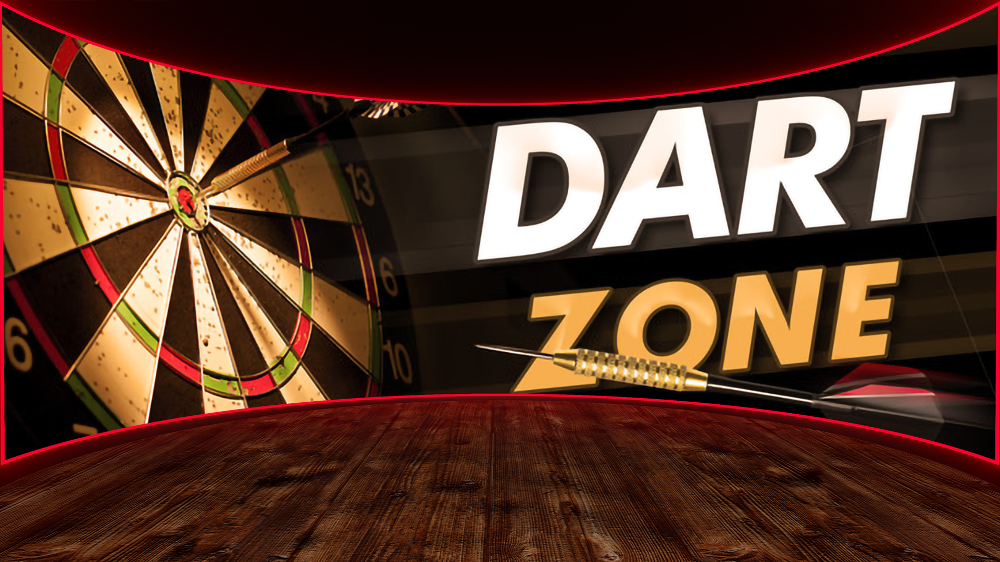

<p align="center">
  
</p>

<h1 align="center">RaspyDarts</h1>

<p align="center">
  <strong>Transformez votre cible électronique en véritable borne de fléchettes, avec un Raspberry Pi.</strong>
</p>

<p align="center">
  <a href="https://github.com/rmdelcelier/RaspyDarts/releases"></a>
  <a href="licence/glpv3.txt"></a>
  
  
  
  <a href="https://raspydarts.wordpress.com/"></a>
  <a href="https://rmdelcelier.github.io/RaspyDarts/"></a>
</p>

---

RaspyDarts est un logiciel complet de borne de fléchettes électronique pour Raspberry Pi.
Il pilote l'affichage, le son, les rubans de LED, les jeux de lumière et le jeu en réseau,
et transforme une cible du commerce en borne digne d'une salle de jeux.

**Site officiel et documentation : [raspydarts.wordpress.com](https://raspydarts.wordpress.com/)**

**Installer sa borne pas à pas : [la page d'installation](https://rmdelcelier.github.io/RaspyDarts/)**
(carte SD, configuration du matériel, personnalisation des menus)

## Fonctionnalités

- **61 jeux** répartis en trois familles : classiques, fun et sport
- **Trophées** : 139 trophées à débloquer, statistiques par joueur
- **5 langues** : français, anglais, allemand, espagnol, italien
- **Jeu en réseau** entre plusieurs bornes, avec serveur maître et statistiques
- **Éclairage synchronisé** : rubans WS281x, cible rétroéclairée, DMX, Philips Hue, afficheur DMD
- **Effets sur événements** : 180, Hat Trick, Bull, White Horse, et bien d'autres
- **Webcam** : photo du joueur sur les événements marquants, envoi optionnel vers Google Drive
- **Thèmes personnalisables** : couleurs, polices, images, sons et vidéos
- **Écran tactile**, boutons physiques, télécommande Bluetooth
- **Scores et records** sauvegardés, joueurs virtuels (PNJ)
- **DMD** affichage des scores sur un DMD via Raspy2DMD

## Matériel

**Raspberry Pi** — Pi Zero 2 W, Pi 3 ou Pi 4, sous **Raspberry Pi OS 13 (Trixie) 32 bits**
avec bureau. Comme sous Buster, les vidéos sont jouées par le processeur graphique au-dessus
de tout : la vidéo d'introduction démarre dès la fin de l'écran de démarrage et le menu est là
dès qu'elle se termine. Le Pi 5 n'est pas pris en charge pour l'instant.

**Cible électronique** — Décathlon ED110, VDarts, GranBoard, ou n'importe quelle autre cible
électronique. Le câblage des segments se fait via les GPIO, avec extension par MCP23017
si la cible demande plus d'entrées que le Pi n'en offre.

**En option**, selon les effets souhaités : ruban de LED WS281x, afficheur DMD MAX7219,
interface DMX, ampoules Philips Hue, webcam USB, écran tactile.

## Installation

La [page d'installation](https://rmdelcelier.github.io/RaspyDarts/) guide chaque étape :
écriture de la carte SD, fichier de configuration de votre matériel, personnalisation des
menus, puis dépôt de ces fichiers sur la carte. Les étapes ci-dessous en sont le résumé.

### Avec l'image RaspyDarts (recommandé)

1. Installez [Raspberry Pi Imager](https://www.raspberrypi.com/software/).
2. Dans ses options (*App Options* → *Content Repository* → *Use custom*), indiquez :
   ```
   https://raw.githubusercontent.com/rmdelcelier/RaspyDarts/main/rpi-imager.json
   ```
3. Choisissez votre modèle de Pi puis l'image **RaspyDarts**, personnalisez le Wi-Fi, le nom de
   la borne et l'utilisateur (`raspydarts` conseillé), et écrivez la carte SD.
4. Au premier démarrage, la borne s'adapte à l'écran branché (elle redémarre une fois si
   l'écran a une résolution particulière, comme les écrans 7 pouces en 1024x600), puis lance
   la vidéo d'introduction et le jeu.

Le jeu est installé dans `/raspydarts` ; la configuration, les thèmes, les scores et les
trophées sont dans `~/.raspydarts`.

### Sur un Raspberry Pi OS neuf (dernière version du dépôt)

Sur une carte Raspberry Pi OS 13 (Trixie) **avec bureau** écrite par Raspberry Pi Imager,
connectez-vous avec le compte qui fera tourner le jeu (`raspydarts` conseillé, pas root) et
lancez :

```
curl -fsSL https://raw.githubusercontent.com/rmdelcelier/RaspyDarts/main/install.sh | sudo bash
```

Le script télécharge le code (environ 1 Go) et la configuration d'exemple (environ 400 Mo),
installe les paquets nécessaires puis configure le démarrage ; prévoyez 6 Go libres.
Redémarrez le Pi à la fin. Options, après `sudo bash -s --` : `--oui` (aucune question),
`--sans-exemple` (garder `~/.raspydarts` tel quel), `--version <branche ou étiquette>`.

### Venir d'une borne en 4.5 (Raspberry Pi OS Buster)

La 4.6.1 change de système : elle s'installe avec la nouvelle image, pas par une mise à jour.
Les bornes en 4.5 ne se voient d'ailleurs jamais proposer la 4.6 par le menu de mise à jour.

Pour garder vos réglages :

- **La configuration** : copiez votre `pydarts.cfg` à la racine de la carte SD juste après
  l'avoir écrite (la partition visible depuis Windows). La borne le récupère et le convertit
  en `raspydarts.cfg` au premier démarrage.
- **Vos thèmes, sons et vidéos** (souvent plusieurs centaines de Mo, trop pour cette petite
  partition) : après le premier démarrage, copiez le contenu de votre ancien dossier
  `.pydarts` dans le partage réseau **Personnalisation Raspydarts** de la borne (son dossier
  `~/.raspydarts`), depuis l'explorateur de fichiers de votre ordinateur.

### Mises à jour

Depuis le menu *Paramètres* → *Vérifier les mises à jour*. Elles sont publiées dans les
[Releases](https://github.com/rmdelcelier/RaspyDarts/releases) nommées `_vX.Y.Z` (version
pour Trixie) ; les releases `vX.Y.Z` sont celles des bornes sous Buster.

### Lancer le jeu à la main

```bash
/raspydarts/RaspyDarts.sh
```

Pour le jeu en réseau, `./pydarts_server.sh` sur chaque borne et `./MasterServer.sh`
sur la machine qui centralise les parties.

## Les jeux

<details>
<summary><strong>Classiques (24)</strong></summary>

321_Zlip · Batard · Bermuda_Triangle · Big6 · Bob27 · By_Fives · Color · Cricket · Duel ·
High_Score · Ho_One · Kapital · Killer · Kinito · Low_Score · Mickey · Practice ·
Round_the_clock · Routine · Scram_Cricket · Shanghai · Shoot-out · Slider · Up_Down_Count_Up

</details>

<details>
<summary><strong>Fun (26)</strong></summary>

Bingo · Bulls · Castle · Challenge · Chaos · Conquer · Dragon · Dungeon · GameOfGoose ·
Hangman · Incendie · Morpion · Othello · Puissance4 · Pursuit · Risk · Robin_Drink ·
Robin_Strip · Sabotage · Simon · Switch · Target · Tower · Treasure · Voleur · Yahtzydarts

</details>

<details>
<summary><strong>Sport (11)</strong></summary>

Balltrap · Baseball · Bowling · Fighters · Football · Golf · Horse · Pingpong ·
Punch-Out · Snooker · Tennis

</details>

## Créer son propre jeu

Un jeu tient dans un seul fichier `.py` déposé dans `games/`. La structure attendue,
les codes de retour et les méthodes à implémenter (`PreDartsChecks`, `PostDartsChecks`,
`EarlyPlayerButton`, `GameStats`, `CheckRecord`) sont documentés dans
**[games/README](games/README)**.

Le plus simple reste de partir d'un jeu existant proche de votre idée et de l'adapter.

## Contribuer

Les contributions sont les bienvenues, quel que soit votre niveau : un nouveau jeu,
une traduction, une correction de bug ou une simple remarque.

**Pour proposer du code :**

1. Forkez le dépôt
2. Créez une branche pour votre modification (`git checkout -b mon-nouveau-jeu`)
3. Committez votre travail
4. Ouvrez une Pull Request

Toute Pull Request est relue et validée avant fusion. La branche `main` est protégée :
elle n'accepte aucune modification directe.

**Pour discuter**, poser une question ou proposer une idée sans écrire de code, rendez-vous
dans l'onglet [Discussions](https://github.com/rmdelcelier/RaspyDarts/discussions).
Pour signaler un bug, ouvrez une [Issue](https://github.com/rmdelcelier/RaspyDarts/issues).

## Licence

RaspyDarts est distribué sous licence **GNU General Public License v3**.
Voir le fichier [LICENSE](LICENSE).
